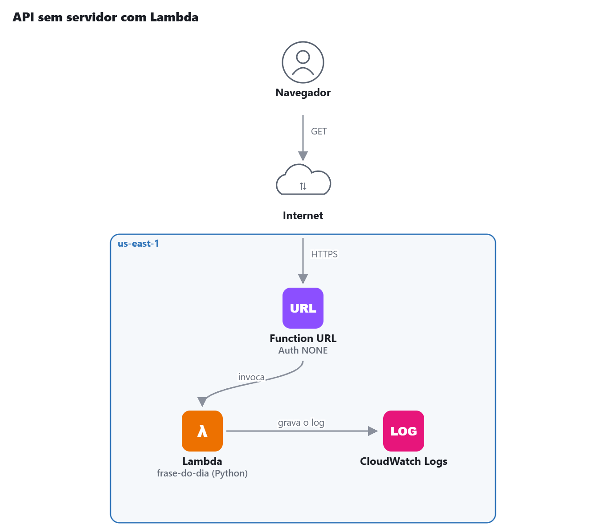

# AWS Lab 03 — API sem servidor com Lambda

Laboratório 3 da minha trilha de estudos para a **AWS Certified Cloud Practitioner (CLF-C02)**.

## Objetivo

Criar uma função AWS Lambda que responde a requisições HTTP pela internet, compreender o conceito de Serverless e explorar a integração com o Amazon CloudWatch.

## Arquitetura

## O que eu fiz

- [x] Criei uma função AWS Lambda.
- [x] Substituí o código pelo código de geração de frases aleatórias.
- [x] Executei testes diretamente no console AWS Lambda.
- [x] Configurei uma Function URL para acesso pela internet.
- [x] Testei a função por meio de uma requisição HTTP.
- [x] Localizei os logs de execução no Amazon CloudWatch.
- [x] Documentei o laboratório.

## Prints

### Função Lambda criada

### Logs no CloudWatch

## O que aprendi

- O AWS Lambda permite executar código sem provisionar ou administrar servidores.
- O conceito de Serverless transfere a administração da infraestrutura para a AWS, mas não elimina os servidores.
- A Function URL permite invocar uma função Lambda por meio de uma URL HTTP(S).
- O Amazon CloudWatch Logs permite visualizar os registros das execuções da função.
- O AWS Lambda utiliza um modelo de cobrança baseado principalmente nas solicitações e no tempo de execução.

## Domínio da prova

Tecnologia — Computação Serverless.

## Limpeza — prevenção de custos

- [x] Excluí a Function URL, caso necessário.
- [x] Excluí a função Lambda.
- [x] Excluí o Log Group no Amazon CloudWatch.
- [x] Verifiquei se não existem outros recursos associados ao laboratório.
